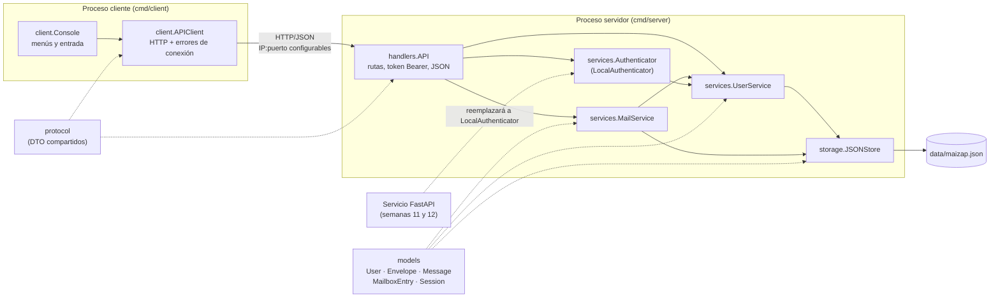
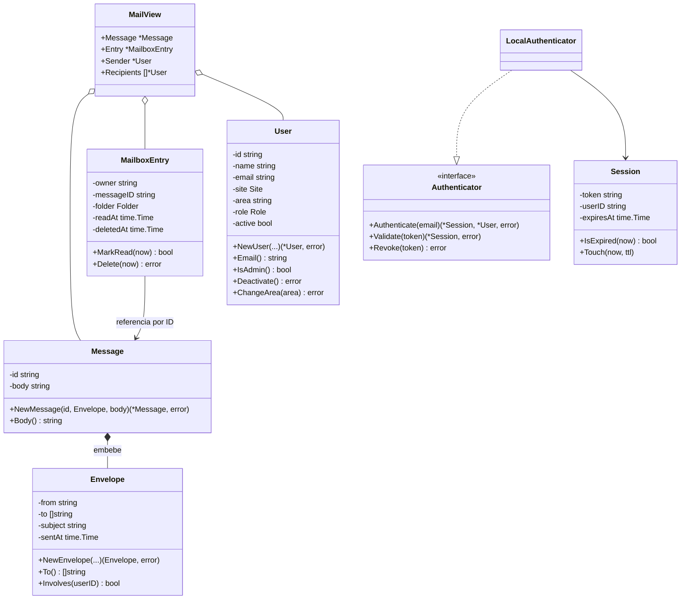
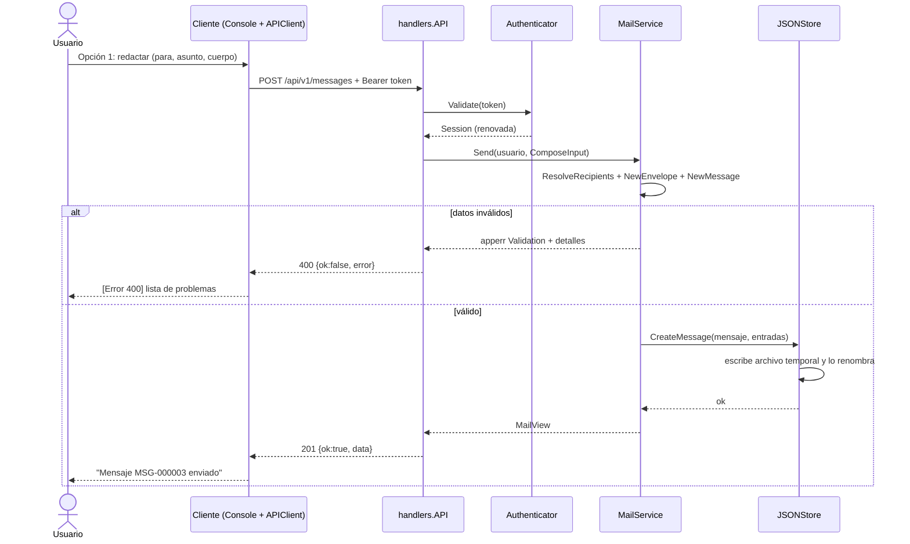

# Documentación técnica · Segundo entregable

> Base editable del documento PDF que se entrega. Complete las secciones marcadas con _Completar_ (capturas, enlaces y contribuciones) y expórtelo a PDF.

---

## Portada

| | |
|---|---|
| **Proyecto** | Proyecto Integrador · Tercer semestre |
| **Asignatura** | Programación Orientada a Objetos |
| **Entregable** | Segundo entregable (semana 10): prototipo funcional cliente-servidor en Go |
| **Sistema seleccionado** | **Opción A · Sistema de correos internos («MaiZap»)** |
| **Integrantes** | Emilio Cuenca · Danna Simaluisa · Camila Villagran |
| **Fecha** | Noviembre de 2026 |

---

## 1. Objetivo del prototipo

Construir una primera versión ejecutable y modular del sistema de correos internos, con un servidor y un cliente en Go que se ejecuten como procesos independientes y se comuniquen por red. El prototipo debe permitir registrar e identificar usuarios, enviar mensajes internos, consultar la bandeja de entrada y los enviados, leer y eliminar mensajes, y validar destinatarios y datos obligatorios. El código debe aplicar structs, constructores, métodos, encapsulamiento, composición, manejo explícito de errores y separación por paquetes.

## 2. Funcionalidades implementadas

| Funcionalidad exigida (Opción A) | Implementación | Estado |
|---|---|---|
| Registrar o identificar usuarios | `POST /api/v1/users`, `POST /api/v1/sessions` (token de sesión) | Completa |
| Crear y enviar un mensaje interno | `POST /api/v1/messages`, con uno o varios destinatarios | Completa |
| Consultar la bandeja de entrada | `GET /api/v1/mailbox/inbox`, con indicador de no leídos | Completa |
| Consultar los mensajes enviados | `GET /api/v1/mailbox/sent` | Completa |
| Leer el contenido de un mensaje | `GET /api/v1/messages/{id}`, que lo marca como leído | Completa |
| Eliminar un mensaje | `DELETE /api/v1/messages/{id}`, con eliminación lógica por buzón | Completa |
| Validar destinatarios y datos obligatorios | Validación en los constructores del modelo y en los servicios; se devuelven todos los problemas a la vez | Completa |
| Funciones adicionales | Directorio de usuarios, desactivación de usuarios por un administrador, cierre de sesión, expiración por inactividad | Completas |

## 3. Requisitos atendidos y requisitos pendientes

> El archivo `especificacion-requisitos.pdf` del repositorio está dañado y no se puede abrir. La tabla usa los requisitos mínimos de la Opción A de la guía de la semana 10. **Antes de exportar, sustituya los códigos por los aprobados en la semana 5** y justifique aquí cualquier cambio, como pide la guía.

### 3.1 Requisitos funcionales

| Código | Requisito | Estado | Evidencia en el código |
|---|---|---|---|
| RF-01 | Registrar usuarios con nombre, correo corporativo, sede y área | Atendido | `services.UserService.Register`, `models.NewUser` |
| RF-02 | Identificar al usuario y mantener una sesión con expiración por inactividad | Atendido (versión provisional) | `services.LocalAuthenticator`, `models.Session` |
| RF-03 | Redactar y enviar un mensaje a uno o varios destinatarios internos | Atendido | `services.MailService.Send` |
| RF-04 | Consultar la bandeja de entrada | Atendido | `MailService.Inbox` |
| RF-05 | Consultar los mensajes enviados | Atendido | `MailService.Sent` |
| RF-06 | Leer un mensaje y registrar la hora de lectura | Atendido | `MailService.Read`, `MailboxEntry.MarkRead` |
| RF-07 | Eliminar un mensaje del buzón propio | Atendido | `MailService.Delete`, `MailboxEntry.Delete` |
| RF-08 | Validar destinatarios (existencia, estado, dominio) y datos obligatorios | Atendido | `UserService.ResolveRecipients`, `models.NewEnvelope` |
| RF-09 | Impedir el acceso a mensajes ajenos y las operaciones administrativas sin permiso | Atendido | `MailService.ownedEntry`, `UserService.Deactivate` |
| RF-10 | Autenticación con contraseña (bcrypt) y JWT mediante el servicio FastAPI | **Pendiente** (semanas 11 y 12) | Punto de extensión: interfaz `services.Authenticator` |
| RF-11 | Despliegue entre Sede A y Sede B (VLAN, OSPF) | **Pendiente** (fases siguientes) | La IP y el puerto ya son configurables |
| RF-12 | Componente estadístico (eventos y métricas de uso) | **Pendiente** | Los logs del servidor ya registran ruta, estado y duración |

### 3.2 Requisitos no funcionales

| Código | Requisito | Estado |
|---|---|---|
| RNF-01 | Cliente y servidor como procesos independientes y con IP y puerto configurables | Atendido |
| RNF-02 | Mensajes de error claros, sin usar `panic` para errores normales | Atendido |
| RNF-03 | Persistencia básica y documentada | Atendido (archivo JSON con escritura atómica) |
| RNF-04 | Código modular por capas | Atendido |
| RNF-05 | Pruebas automatizadas reproducibles | Atendido (`go test ./...`) |
| RNF-06 | Comunicación cifrada con TLS | Pendiente |

### 3.3 Cambios respecto al diseño previo

| Cambio | Justificación |
|---|---|
| La identificación usa solo el correo, sin contraseña | La guía de la semana 10 pide no duplicar en Go el servicio de autenticación de Fundamentos de Seguridad. La interfaz `Authenticator` permite reemplazar la implementación sin tocar los handlers. |
| Se usa un archivo JSON en lugar de una base de datos | La guía permite archivos o JSON justificados. Reduce dependencias y hace reproducible la demostración. `JSONStore` queda aislado en `internal/storage`, por lo que se puede cambiar sin afectar a los servicios. |
| Se agregó la desactivación de usuarios por un administrador | Permite demostrar el manejo de «operaciones no autorizadas» y la validación de destinatarios desactivados. |

## 4. Diagrama de componentes y módulos

### Diagrama de estructuras

## 5. Comunicación cliente-servidor

- **Transporte**: HTTP/1.1 sobre TCP. El servidor escucha en `host:port`, configurables con `-host` y `-port` o con `MAIZAP_HOST` y `MAIZAP_PORT`. El cliente se conecta con `-host` y `-port` o con `MAIZAP_SERVER_HOST` y `MAIZAP_SERVER_PORT`.
- **Formato**: JSON. Toda respuesta usa el sobre `{"ok": bool, "data": ..., "error": {"code","message","details"}}`, definido en `internal/protocol`, que comparten ambos programas.
- **Sesión**: `POST /api/v1/sessions` devuelve un token aleatorio de 192 bits. El cliente lo envía en `Authorization: Bearer <token>`. Cada uso renueva la expiración (30 minutos por defecto).
- **Errores**: cada categoría de `apperr` se traduce en un código HTTP (400, 401, 403, 404, 409 o 500). El cliente distingue entre un **error de conexión** (servidor apagado, IP o puerto incorrectos, tiempo agotado) y un **error de la aplicación** (respuesta del servidor con mensaje y detalles).

## 6. Principales estructuras, constructores y métodos

| Concepto de POO | Dónde se aplica |
|---|---|
| **Structs para las entidades** | `models.User`, `models.Envelope`, `models.Message`, `models.MailboxEntry`, `models.Session` |
| **Campos no exportados** | Todos los campos de las entidades son privados. Se leen con métodos (`Email()`, `Subject()`, `IsRead()`...), así que ningún paquete externo puede dejar una entidad en un estado inválido. |
| **Campos exportados** | Los DTO de `protocol`, los registros de `storage` (`UserRecord`...) y `services.MailView`, porque su responsabilidad es transportar datos y serializarlos a JSON. |
| **Constructores con estado válido** | `NewUser`, `NewEnvelope`, `NewMessage`, `NewMailboxEntry`, `NewSession`, `NewUserService`, `NewMailService`, `NewLocalAuthenticator`, `NewAPI`, `NewAPIClient`, `NewConsole`, `OpenJSONStore`. Los constructores del modelo devuelven `(*T, error)` y acumulan todos los problemas encontrados. |
| **Receptores por puntero** | `(*User).Deactivate`, `(*User).ChangeArea`, `(*MailboxEntry).MarkRead`, `(*MailboxEntry).Delete` y `(*Session).Touch` modifican el estado. Los servicios y el almacén usan punteros para compartir su `sync.Mutex`. |
| **Receptores por valor** | `Envelope` es inmutable y sus métodos (`To()`, `Involves()`) usan receptor por valor. `To()` devuelve una copia del slice para proteger el estado interno. |
| **Encapsulamiento** | La entidad solo cambia mediante sus métodos: por ejemplo, `Delete` impide eliminar dos veces y `MarkRead` es idempotente. El almacén devuelve copias, nunca referencias a su estado interno. |
| **Composición** | `Message` **embebe** `Envelope`, por lo que sus métodos (`From()`, `Subject()`, `SentAt()`) se promueven. `MailView` compone mensaje, entrada de buzón, remitente y destinatarios. `MailService` contiene un `UserService`, y `handlers.API` agrupa los servicios. |
| **Interfaz con propósito** | `services.Authenticator` separa la identificación del resto del servidor. Su única implementación actual, `LocalAuthenticator`, se reemplazará por un adaptador del servicio FastAPI. No se crearon interfaces que no tengan ese propósito. |
| **Reutilización** | `writeData`, `writeError`, `decodeJSON` y el middleware `requireSession` en `handlers`; `APIClient.do` en el cliente; `combineValidation` en `services`. |
| **Manejo explícito de errores** | El tipo `apperr.Error` tiene categoría, mensaje, detalles y causa (`Unwrap`), y se consulta con `errors.As`. El cliente define `ConnectionError` y `APIError`. No se usa `panic`. Un middleware `recoverer` evita que un fallo inesperado detenga el servidor. |
| **Validación de datos del cliente** | `decodeJSON` (tipo de contenido, tamaño máximo, campos desconocidos, objeto único), los constructores del modelo y `ResolveRecipients`. |

## 7. Gestión de los datos

- `storage.JSONStore` guarda usuarios, mensajes y entradas de buzón en `data/maizap.json`.
- Un mensaje se guarda **una sola vez**, y cada participante tiene una `MailboxEntry` (carpeta `inbox` o `sent`) con su propio estado de lectura y de eliminación. Así, eliminar un mensaje en un buzón no lo borra del buzón de los demás.
- Cada escritura serializa el estado en un archivo temporal y luego lo **renombra**, lo que evita dejar el archivo corrupto si el proceso se interrumpe. Si la escritura falla, se **revierte** el cambio en memoria y se devuelve un error de almacenamiento.
- Al iniciar, el servidor valida cada registro con los constructores del modelo. Un archivo corrupto se informa con un mensaje claro y el servidor no arranca con datos inválidos.
- **Limitación**: las sesiones viven en memoria y se pierden al reiniciar el servidor.

## 8. Evidencias de ejecución

> _Completar con capturas propias._

1. Servidor iniciado (`go run ./cmd/server`), mostrando la IP y el puerto.
2. Cliente conectado («Conectado a 127.0.0.1:8080»).
3. Identificación y bandeja de entrada con mensajes no leídos.
4. Envío de un mensaje válido y su aparición en «Mensajes enviados».
5. Lectura del mensaje en la cuenta del destinatario.
6. Error de validación con destinatarios inexistentes y campos vacíos.
7. Operación no autorizada (403) al intentar desactivar un usuario sin ser administrador.
8. Error de conexión con el servidor detenido.
9. Resultado de `go test ./...`.

## 9. Limitaciones actuales del prototipo

- Identificación provisional sin contraseña, a la espera de la integración con FastAPI.
- Sesiones en memoria, que no sobreviven a un reinicio.
- Persistencia en un único archivo JSON, sin índices ni concurrencia entre varios servidores.
- HTTP sin TLS.
- Sin adjuntos, respuestas en hilo, búsqueda, paginación ni papelera.
- Las pruebas se hicieron en un equipo local o en la red del laboratorio. Falta la integración entre sedes.

## 10. Alternativas evaluadas y postura del equipo

Las decisiones de diseño se tomaron comparando alternativas con criterios explícitos, no como verdades dadas.

| Decisión | Alternativas consideradas | Evidencia o criterio | Elección y límite reconocido |
|---|---|---|---|
| Protocolo cliente-servidor | Sockets TCP con protocolo propio, gRPC, HTTP REST con JSON | REST con JSON se puede probar con `curl` y con `httptest`, no requiere generar código y coincide con el modelo que usará el servicio FastAPI | **HTTP/JSON**. Agrega algo más de sobrecarga que TCP puro, lo que es irrelevante para el volumen de correo interno. |
| Persistencia | Memoria pura, SQLite, PostgreSQL, archivo JSON | La guía exige un mecanismo «básico y justificado». La memoria pura pierde todo al reiniciar, y SQLite o PostgreSQL agregan dependencias e instalación | **Archivo JSON con escritura atómica**. No escala a muchos usuarios concurrentes. Por eso queda aislado en `storage` para reemplazarlo. |
| Identificación | Contraseñas con bcrypt en Go, JWT propio, identificación por correo | La guía pide **no duplicar** el componente de Fundamentos de Seguridad | **Identificación por correo detrás de `Authenticator`**. Es insegura fuera del laboratorio, lo que se reconoce como limitación temporal. |
| Eliminación de mensajes | Borrado físico, borrado lógico por buzón | Un borrado físico eliminaría el mensaje también para los demás participantes y afectaría la trazabilidad | **Eliminación lógica por buzón**. Por ahora no existe papelera para recuperar mensajes. |
| Interfaces | Una interfaz por servicio y por repositorio, o solo donde haya un reemplazo previsto | La guía advierte contra la complejidad artificial | **Una interfaz (`Authenticator`)**, porque es la única pieza con un reemplazo ya planificado. |

**Postura del equipo**: para esta fase, un prototipo pequeño, verificable y con límites declarados aporta más que uno con más funciones pero frágil. Esta postura tiene un costo: el prototipo no muestra seguridad real ni escalabilidad. Ese costo se acepta porque ambos aspectos tienen una fase planificada (semanas 11 y 12) y el diseño ya deja preparados sus puntos de extensión.

## 11. Conclusiones

- **Logros**: se obtuvo un prototipo ejecutable con cliente y servidor independientes que cubre todas las operaciones mínimas de la Opción A y responde con mensajes claros ante los ocho escenarios de error de la guía. Las pruebas automatizadas verifican el flujo completo.
- **Decisiones y sus límites**: se priorizó la reproducibilidad (biblioteca estándar y archivo JSON) sobre la escalabilidad, porque la meta de esta fase es demostrar la arquitectura y los fundamentos de POO. El costo es que el almacenamiento no escala, una limitación que se acepta conscientemente y que está aislada en `storage`.
- **Implicaciones para las siguientes fases**: la interfaz `Authenticator` y la configuración de IP y puerto preparan la integración con FastAPI y el despliegue entre sedes. Los logs por solicitud son la base del componente estadístico.

## 12. Enlaces

| Recurso | Enlace |
|---|---|
| Repositorio Git | https://github.com/Dicami/Gestion-de-correos-internos--Proyecto-Integrador-- (rama `emilio-cuenca`) |
| Video demostrativo | _Completar_ |

## 13. Contribuciones del equipo

| Integrante | Contribución |
|---|---|
| Emilio Cuenca | _Completar_ |
| Danna Simaluisa | _Completar_ |
| Camila Villagran | _Completar_ |
